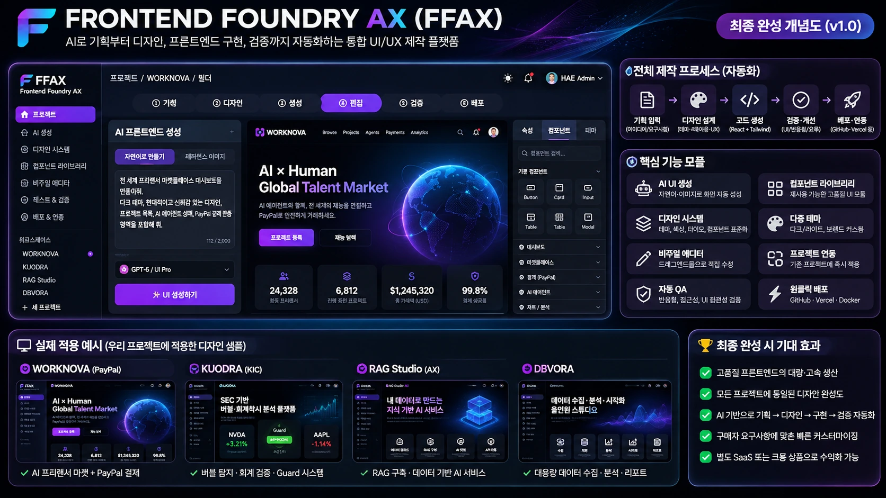

> **2026-11-14 최신: React A/B 반응형 미리보기↔TSX 내보내기 일치**, 소스 SHA `69d26097d23a41a7fad49712c9e38589d3b7f9c8`. [GitHub Actions 4/4 SUCCESS](https://github.com/hibi89/frontend-foundry-ax/actions/runs/43549618123), Linux/Windows **119/119 PASS 각각**, 실제 Chromium 미리보기 375px=1열 / 768px=2열 / 1440px=4열, A/B 총6/6 PASS; axe serious/critical0. 최신 서명되지 않은 Windows 검수 ZIP artifact `14095494091`(7일), 정확 SHA·22파일/ZIP SHA256 `63632430069bf919523deeb529b982f039df68f52ac299011892afd3b91601a9` 확인, 별도 압축 해제본 HTTP200/404/403 스모크 PASS. **실 Qwen12문항·사용자 UX 미검증**, 고정 기술 잠정 **80/100**, 공식 최종설계 **UNASSESSED**, 출시·크몽 **HOLD**. [수정 증거](docs/REACT_GRID_EXPORT_PARITY_20261114.md).

> **2026-11-14 FFAX 최신 코드 0acf96c9:** 미리보기 A/B 레이아웃과 React TSX 내보내기 불일치 수정. [GitHub Actions 4/4 SUCCESS](https://github.com/hibi89/frontend-foundry-ax/actions/runs/43548778693); Linux·Windows Node **118/118 PASS 각각**, React19 strict/SSR synthetic12, Chromium 3폭/axe/cleanroom PASS. 최신 22파일 검수 ZIP artifact `14095432154` (7일), source SHA `0acf96c95d133c02f3666238fd638a4f3468f854`, ZIP SHA256 `0305998d4b373bb46a8c239aed9d4bf7abb520c27d90a6d38deb497b0d892b8f`. 실제 로컬 Qwen 생성·사용자 Windows UX 미검증. **독립 엔지니어링 80/100 잠정, 중앙 공식 최종설계 UNASSESSED, RELEASE HOLD, 크몽 미등록.** [레이아웃 수정 검증](docs/REACT_GRID_EXPORT_PARITY_20261114.md).

> **2026-11-14 최신 검증:** 고정 rubric **80/100 엔지니어링 잠정**, 중앙 공식 최종설계 **UNASSESSED**, **RELEASE HOLD**. 검증된 코드 `e5982bf53ea9e65625051d2f3937abfc2ce979ba`: [Actions 4/4 SUCCESS](https://github.com/hibi89/frontend-foundry-ax/actions/runs/43547649624), Linux/Windows **115/115 각각 PASS**, 실 localhost Host/정적파일 접근 방어 및 사용자 검수 ZIP 자체 검증. 실제 Qwen 12문항/Windows 사용자 승인 **미검증**. 압축본 artifact `14094548197` (7일); `RUN-LIVE-MODEL-CHECK.cmd`는 12문항에 대해 최대 120초/문항·부분 영수증·장애시 조기 중단을 제공. ZIP SHA256 `6dbb1f2ffa5198b50b37e9b2e213f53bd16240a6a1cea8d83dfef534f190d087`. [최종 요구 추적표](docs/FINAL_BLUEPRINT_TRACE_20261114.md) · [검수 안내](OWNER_QUICKSTART_KO.md).

> **2026-11-14 최신: 80/100 잠정 기술 기준 / 중앙 정식 최종완성률 UNASSESSED / RELEASE HOLD.** Linux·Windows 113/113, GitHub CI 4/4, axe 0 serious/critical, 검수용 Windows ZIP 있음. 실로컬 모델 AC04 0, 사용자 최종승인 AC09 0. [증거](docs/FFAX_CI_AND_RELEASE_GATE_20261114.md) · [Windows 검수 안내](OWNER_QUICKSTART_KO.md).

> **2026-11-12 P85 attempt (engineering score 78/100 retained):** Local JSON project save/reopen with strict validation, user confirmation and Undo recovery now works. Node105 PASS, Chromium UI30 + project restore9 PASS (injected-source scope). **This is not 85%, not deployed, release HOLD.** [Evidence](docs/FFAX_P85_LOCAL_PROJECT_RESTORE_20261112.md). 

## 2026-11-12 — AI provider adapter + formal audit preparation (P78 retained)
- Local-first production provider adapter contract added, but **no paid/live LLM request**. Node **96/96 PASS**, 12/12 mocked design messages, Chromium 30/30, React UMD 12/12, cleanroom 7/7.
- axe 4.14 audit script added; local binary missing so **NOT VERIFIED**, actual user UX approval pending. CI manual-only, not executed. **78/100 provisional unchanged**, RELEASE HOLD.
- [Detailed evidence](docs/FFAX_P85_PROVIDER_ADAPTER_GATE_20261112.md) · [Owner UX approval checklist](docs/OWNER_UX_REVIEW_V1.md).

> **2026-11-12 FFAX P85 third pass — 78/100 provisional (unchanged), 85 target NOT reached.** [Manual AI bridge + six-step clean-room verification](docs/FFAX_P85_MANUAL_BRIDGE_AND_CLEANROOM_20261112.md). Added browser approval flow: copy an explicitly vetted UI prompt to a model yourself, paste strict JSON, approve, and edit the resulting UI. **This is manual AI-assisted review, not live API generation.** Local Node 91 PASS / browser 30 + manual bridge 10 PASS / a11y basics 12 PASS / contrast 828 checks / clean-room 6 PASS. GitHub Actions config manual-dispatch only, **never run**; real LLM, axe, owner UX signoff, clean CI and Production remain unverified. 

---

> **2026-11-12 FFAX 85% 재도전 — 검증된 78/100점 잠정 유지.** 실제 구현·검증은 증가했지만 AC04/AC09/AC12의 필수 수락 게이트는 미완료다. [이번 구현 및 재현 로그](docs/FFAX_P85_SECOND_PASS_20261112.md). 새 코드: 구조화된 모델 출력→등록 컴포넌트→React TSX 안전 변환, 12개 합성 타입 검사, D1–D5 로컬 통합 시나리오, 3테마×3폭 대비 검수. **실제 모델·axe·GitHub CI·배포는 미검증**. 실행: `npm run check:offline` (Node>=20, TypeScript CLI, Python Playwright/Chromium 및 레거시 React UMD 경로 필요).

---

> **2026-11-12 FFAX P85 워크스트림:** 검증된 고정 평가표 **78/100점 잠정** (이전75 + AC11 3). **85점 목표 미달 / RELEASE HOLD**. `feature/ffax-workbench-p85-20261112`의 [P85 범위·실측·한계](docs/FFAX_P85_WORKSTREAM_EVIDENCE_20261112.md)를 먼저 확인. 외부 AI 실연동, axe/수동 UX 검토, clean CI는 미검증. 아래 P75 README는 이전 체크포인트.

---

# FRONTEND FOUNDRY AX (FFAX)

> **Latest P75 development (2026-11-12 KST): 75/100 provisional engineering score**, feature branch `feature/ffax-workbench-p75-20261112`, [Draft PR #1](https://github.com/hibi89/frontend-foundry-ax/pull/1) unmerged, RELEASE HOLD. Earlier P50 below is historical. [P75 evidence](docs/FFAX_P75_ENGINEERING_EVIDENCE_20261112.md).

## Safe local React project review (v0.2)

Use the new CLI to **inspect a synthetic React fixture, create an isolated snapshot, preview an allowlisted CSS-only change, require explicit approval, compare API flows and verify an exact rollback**. It never modifies the original source, requires no credentials, does not run imported code, and does not push or deploy.

```bash
npm install --ignore-scripts
npm test   # 49/49 local Node tests
node scripts/workspace_cli.mjs inspect fixtures/react-market
node scripts/workspace_cli.mjs import fixtures/react-market /tmp/ffax-workspaces demo-market
# Place your own UI CSS change in /tmp/new-theme.css first
node scripts/workspace_cli.mjs preview /tmp/ffax-workspaces/demo-market /tmp/new-theme.css
node scripts/workspace_cli.mjs apply /tmp/ffax-workspaces/demo-market /tmp/new-theme.css p75-demo-0001 APPROVE_UI_PATCH
node scripts/workspace_cli.mjs verify-original /tmp/ffax-workspaces/demo-market
node scripts/workspace_cli.mjs rollback /tmp/ffax-workspaces/demo-market p75-demo-0001 APPROVE_ROLLBACK
```

The two fixtures include five API/UI flows each. TSX handlers are executed under a React API **stub**; actual React runtime, real GitHub imports, Windows and customer repos have not been validated. See P75 evidence before treating the 75% figure as production readiness.


> **v0.1 local-first workbench implemented on `feature/ffax-workbench-p50-20261112` — P50 technical milestone (50/100 provisional), RELEASE HOLD. The v1.0 product is not complete.**



*User-approved vision poster, converted to WebP for repository viewing. This is concept art, not a screenshot of a shipped product.*

## Run the current prototype

```bash
npm install --ignore-scripts
npm start
# Open http://127.0.0.1:4173 on your local machine
npm test
# Optional Linux Chromium probe (requires Python Playwright, Pillow and /usr/bin/chromium):
python scripts/browser_qa.py
```

The prototype runs locally without any paid AI API, secret, external project connection or cloud deployment. It offers rule-based structured Korean briefs, 2 design options, 13 UI components, 3 themes, editable component properties, drag/move, undo/redo, locally approved reference image palette/layout variants, React TSX source export and a quick 3-width UI check. **It is not yet a working LLM-to-React production pipeline or GitHub-app integration.**

**Tests:** Node 24 PASS, headless Chromium *same-source injected DOM* 30 PASS; locally hosted HTTP GET 200. Chromium URL navigation directly to localhost was blocked by this execution environment; actual browser navigation against the URL, Windows and React runtime integration remain **unverified**.

[Implementation evidence](docs/FFAX_P50_ENGINEERING_EVIDENCE_20261112.md) · [100-point rubric](docs/ACCEPTANCE_MATRIX.md) · [Status](STATUS.md) · [Handoff](HANDOFF.md)

---

FFAX is a proposed AI-powered frontend production system: **brief → design → React code → visual editing → browser-based QA → reviewed integration**. Its purpose is to build and improve reusable, production-grade user interfaces while preserving existing application functionality.

## Final product definition

The authoritative **v1.0 completion contract** is [REQUIREMENTS.md](REQUIREMENTS.md) together with [docs/ACCEPTANCE_MATRIX.md](docs/ACCEPTANCE_MATRIX.md). Requirements are not complete unless objective evidence and release gates pass.

- **Full product specification:** [docs/PRODUCT_SPEC_V1.md](docs/PRODUCT_SPEC_V1.md)
- **Seven practical use cases + how AI generation and visual editing work:** [docs/USE_CASES_AND_IMPLEMENTATION_V1.md](docs/USE_CASES_AND_IMPLEMENTATION_V1.md)
- **Productivity validation method (not actual measured results):** [docs/PRODUCTIVITY_BENCHMARK_PLAN.md](docs/PRODUCTIVITY_BENCHMARK_PLAN.md)
- **Architecture and alternatives:** [docs/ARCHITECTURE_DECISIONS.md](docs/ARCHITECTURE_DECISIONS.md)
- **Development rules:** [AGENTS.md](AGENTS.md)
- **Current progress:** [STATUS.md](STATUS.md)
- **Handoff:** [HANDOFF.md](HANDOFF.md)

## Intended UI

The previously reviewed **FFAX concept poster is design direction, not a functional screenshot**. Its example KPI values, projects and integration badges are illustrative and do not constitute shipped features or verified metrics.

The target layout is a dark, crisp workspace: left project navigation and prompt panel; center live preview/canvas; right component, property and QA panels; top workflow navigation; portfolio of product previews beneath. A visually equivalent WebP copy of the approved poster is now stored at `assets/concepts/ffax-v1-vision.webp` (verified blob SHA `01d42b4e74eed25a3b23ec6966f77b6bd7b22e54`). The original PNG remains a separate source file outside GitHub.

## Boundaries

- Preserve existing repositories, production behavior and original data. No unapproved deployment, security change or external transmission.
- UI quality is judged on **rendered browser output**, not code generation alone.
- Imported design references and open-source packages require license/provenance checks.
- Every acceptance criterion must have a reproducible test, screenshot, log, or documented manual review.

**Status:** 50/100 provisional technical milestone on feature branch; RELEASE HOLD; deployment NOT APPLICABLE.
